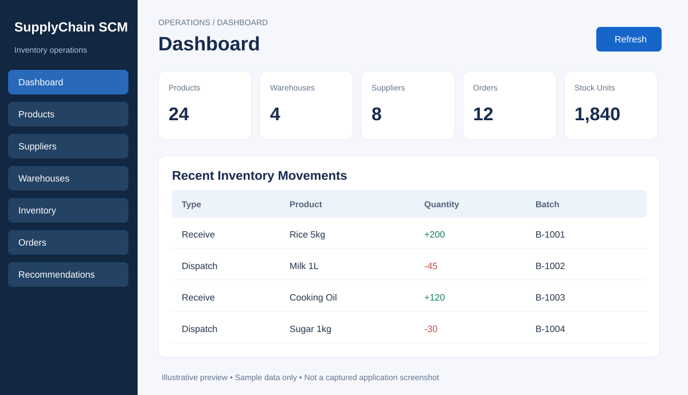

# Smart Inventory & Supply Chain Management System

**Design Project 1 | MERN Full-Stack Application | Review 1**

A browser-based inventory and supply chain management prototype connecting **products, suppliers, warehouses, stock movements, purchase orders, replenishment suggestions, and operational reporting**.

> **Project status:** Source code is available. Deployment, end-to-end browser testing with MongoDB, and production readiness have **not** been verified. Screenshots and example JSON/CSV below are **illustrative**. Features described as planned must not be presented as implemented.



## Contents

1. [Project overview](#project-overview)
2. [Problem statement](#problem-statement)
3. [Architecture](#architecture)
4. [Technology stack](#technology-stack)
5. [Repository structure](#repository-structure)
6. [Requirements](#requirements)
7. [Installation and startup](#installation-and-startup)
8. [First-time demonstration](#first-time-demonstration)
9. [Modules and implementation status](#modules-and-implementation-status)
10. [API guide](#api-guide)
11. [Database schema](#database-schema)
12. [Inventory and procurement business rules](#inventory-and-procurement-business-rules)
13. [Sample output](#sample-output)
14. [Tests and validation](#tests-and-validation)
15. [Security considerations](#security-considerations)
16. [Troubleshooting](#troubleshooting)
17. [Review 1 presentation guidance](#review-1-presentation-guidance)
18. [Future scope](#future-scope)

## Project overview

The application is designed for organizations managing products across different warehouses and suppliers. An administrator or warehouse manager maintains the product catalog, supplier directory, and warehouse locations. Staff record goods received or dispatched; the backend updates stock and keeps a movement history. Managers can create and approve purchase orders; replenishment suggestions are calculated from product thresholds and quantities held at each warehouse.

### Academic project information

- **Project:** Smart Inventory and Supply Chain Management System
- **Mentor:** Dr. M. Senbagavalli
- **Course:** Design Project - 1, E1CSA313
- **Team:** Bale Sunil Kumar Reddy, Abhishek G, Pothana Varshith Sai, Belli Vinay Babu
- **Research / implementation focus:** Centralized inventory, multi-location visibility, procurement workflows, authenticated role access, and transaction integrity.

## Problem statement

Manual spreadsheets and disconnected warehouse records can cause inventory discrepancies, avoidable shortages, delayed purchase decisions, and poor visibility across locations. This project builds a centralized application to enter, inspect, and manage those records in one place. It does **not** claim to eliminate all stock errors or represent a completed enterprise SCM system.

### Objectives

- Maintain reusable product, supplier, and warehouse records.
- Record inbound and outbound stock changes with an audit trail.
- Avoid negative stock in supported movement transactions.
- Provide order approval, confirmation, and partial-receipt processing.
- Suggest replenishment quantities from deterministic stock rules.
- Present dashboard totals and an inventory CSV export.
- Provide an extensible MERN foundation for future QR scanning and notifications.

## Architecture

```text
Browser (React + Vite)
  ├── Login and session token
  ├── Dashboard / Products / Suppliers / Warehouses
  ├── Inventory / Purchase Orders / Recommendations
  └── HTTP JSON requests
              │
              ▼
Node.js + Express REST API
  ├── JWT authentication + role checks
  ├── Zod input validation
  ├── Inventory movement and PO business rules
  ├── Audit records
  └── Socket.IO stock-change emission (server)
              │
              ▼
MongoDB + Mongoose
  ├── users, suppliers, warehouses, products
  ├── stocks, movements, purchaseorders
  └── audits
```

**Important architecture note:** The backend emits a `stock:changed` Socket.IO event after inventory changes. The current React interface primarily refreshes through API requests; a verified live Socket.IO UI subscription is not included in this repository version. Stock moves and order receipts use MongoDB transactions and therefore require a replica set or MongoDB Atlas configuration supporting transactions.

## Technology stack

| Area | Actual source technology |
|---|---|
| Frontend | React 18, Vite, JSX, CSS |
| Backend | Node.js (ES modules), Express |
| Database | MongoDB, Mongoose |
| Login / roles | JSON Web Tokens, bcryptjs |
| Validation / security | Zod, Helmet, CORS, express-rate-limit |
| Real-time server | Socket.IO (event emission) |
| Tests | Node built-in test runner |
| Recommended development tools | VS Code, MongoDB Compass, Postman |

The uploaded application is JavaScript-based, not Python-based. It also does **not** currently use Redux, Tailwind CSS, Prisma, cloud AI, or a separate graph database.

## Repository structure

```text
Supply-Chain/
├── README.md
├── .gitignore
├── client/
│   ├── .env.example
│   ├── index.html
│   ├── package.json
│   └── src/
│       ├── main.jsx          # React UI, navigation and API calls
│       └── style.css         # Responsive layout and styling
├── server/
│   ├── .env.example
│   ├── package.json
│   ├── index.js              # Express routes and server startup
│   ├── models.js             # Mongoose schemas
│   ├── rules.js              # Pure inventory/procurement rules
│   ├── seed.js               # Create demo administrator
│   └── tests/
│       └── rules.test.js
├── docs/
│   └── dashboard-preview.svg # Illustrated mockup, not runtime screenshot
└── sample-output/
    ├── README.md
    ├── dashboard-summary.json
    ├── inventory.csv
    └── purchase-orders.json
```

## Requirements

- Node.js 20 or later and npm.
- Git, terminal and an up-to-date browser.
- MongoDB Atlas or **local MongoDB replica set**. MongoDB standalone does not support the transactions used by the stock and purchase-order receipt routes.
- Two local ports available: **4000** (API) and **5173** (Vite).
- Never commit passwords, tokens or local `.env` files.

## Installation and startup

### 1. Clone the repository

```bash
git clone https://github.com/sunilkumarreddy-bale/Supply-Chain.git
cd Supply-Chain
```

### 2. Configure MongoDB

**Recommended for easier transaction support: MongoDB Atlas.** Create a database deployment, authorize your development IP address, add a database user, and copy the MongoDB driver connection string. Replace its placeholders with your credentials. Store the resulting connection string **only** in `server/.env`.

For a locally configured MongoDB replica set, your URI may resemble:

```text
mongodb://127.0.0.1:27017/scm?replicaSet=rs0
```

This is only an example. You must first initialize and run that replica set; putting `replicaSet=rs0` in a URI does not create one.

### 3. Configure and install backend

On macOS / Linux:

```bash
cd server
cp .env.example .env
npm install
```

On Windows PowerShell:

```powershell
cd server
Copy-Item .env.example .env
npm install
```

Edit `server/.env`:

```dotenv
PORT=4000
MONGO_URI=your_mongodb_atlas_or_replica_set_connection_string
JWT_SECRET=replace_with_a_random_secret_of_at_least_32_characters
CLIENT_ORIGIN=http://localhost:5173
SEED_ADMIN_PASSWORD=choose_a_unique_strong_password
```

**Do not use the example secrets or publish the real values.** `JWT_SECRET` requires at least 32 characters; `SEED_ADMIN_PASSWORD` requires at least 10 characters.

### 4. Create the first administrator

While inside `server/`:

```bash
npm run seed
```

This creates `admin@scm.local` with the password from `SEED_ADMIN_PASSWORD`, if it does not already exist. Running seed again does not reset the existing administrator password.

### 5. Start backend

```bash
npm run dev
```

Expected server message after a successful database connection:

```text
SCM API running
```

Check `http://localhost:4000/api/health` and expect a JSON object containing `"status":"ok"`.

### 6. Configure and start frontend

Open a **second terminal** at the repository root:

```bash
cd client
cp .env.example .env
npm install
npm run dev
```

On Windows PowerShell, use `Copy-Item .env.example .env` instead of `cp`. The frontend config should contain:

```dotenv
VITE_API_URL=http://localhost:4000
```

Open the local Vite URL (typically `http://localhost:5173`) in your browser. Log in with:

- **Email:** `admin@scm.local`
- **Password:** the password set in your own `SEED_ADMIN_PASSWORD`.

Do not use sample data files as though they had already been imported: those files are examples, not automatic database seed records.

## First-time demonstration

Carry out the following sequence in the browser after the services start:

1. **Suppliers:** Add a supplier, for example `ABC Wholesale`.
2. **Warehouses:** Add `Main Warehouse`, code `WH-MAIN`.
3. **Products:** Register SKU `RICE-5KG`, product `Rice 5kg`, reorder point `10`, target stock `40`, and select the supplier.
4. **Inventory:** Choose the product and warehouse and receive 5 units under batch `B-1001`.
5. **Dashboard:** Refresh and confirm the stock total increased.
6. **Recommendations:** With 5 units and a target of 40, the deterministic suggested reorder quantity is **35 units**.
7. **Orders:** Create a draft purchase order for 35 units, approve it, and confirm it.
8. **Order receipt:** Receive the remaining order quantity. The order status should become `received`, and inventory should increase.
9. **CSV report:** The authenticated `GET /api/stock.csv` API downloads a current stock snapshot (currently the React UI does not provide a dedicated CSV export control).
10. **Tests:** Run `npm test` in the backend directory.

This is a reproducible **intended demo procedure**; it is not a statement that these steps have already passed complete end-to-end verification.

## Modules and implementation status

| Module | Current repository status | Important limitations |
|---|---|---|
| Login | Source implemented | JWT login, no password-reset flow |
| Role access | Backend role checks implemented | Only administrator seeding is provided; supplier accounts are not linked to supplier records |
| Product catalog | List and create UI/API | Edit, delete, bulk import not implemented |
| Suppliers | List and create UI/API | Supplier self-service requires more work |
| Warehouses | List and create UI/API | Zones and bins not modeled |
| Stock receiving / dispatch | UI/API source implemented | Replica-set transaction requirement |
| Multi-warehouse visibility | Stock is associated with warehouse | Warehouse-to-warehouse transfer transaction not implemented |
| Movement history | Backend list endpoint | Limited on-screen presentation |
| Purchase order | Draft, approval, confirmation, partial/full receiving | Supplier-role ownership authorization needs correction before production |
| Reorder suggestions | Reorder-point/target-stock calculation | Does not auto-create purchase orders |
| Dashboard | Summary counts and quantities | No live charts |
| Reporting | Authenticated stock CSV endpoint | No PDF report or scheduled export |
| Audit | Movement, order and create-action logs | Dedicated audit viewer not included |
| Socket.IO | Backend emits stock-change event | Live frontend subscription not verified |
| QR/barcode | Proposed in Review 0 | Not implemented in this GitHub version |
| Email/SMS notifications | Proposed | Not implemented |
| Expiry alerts | Proposed | Not implemented |
| Cloud deployment | Proposed | No deployed URL or live test evidence |
| SupplyChain DNA | Separate research idea | Not integrated into this repository |

## API guide

All routes below except login and health require the header:

```http
Authorization: Bearer YOUR_JWT_TOKEN
```

| Method | Endpoint | Purpose |
|---|---|---|
| GET | `/api/health` | API health |
| POST | `/api/login` | Authenticate and receive JWT |
| GET | `/api/me` | Current account |
| GET / POST | `/api/products` | List/create products |
| GET / POST | `/api/suppliers` | List/create suppliers |
| GET / POST | `/api/warehouses` | List/create warehouses |
| GET | `/api/stock` | List inventory lots |
| POST | `/api/stock/move` | Receive or dispatch stock |
| GET | `/api/movements` | Most recent 100 stock movements |
| GET | `/api/recommendations` | Reorder suggestions |
| GET / POST | `/api/orders` | List/create purchase orders |
| POST | `/api/orders/:id/status` | Approve, confirm or reject |
| POST | `/api/orders/:id/receive` | Receive quantity on purchase order |
| GET | `/api/summary` | Dashboard counters |
| GET | `/api/stock.csv` | Stock export as CSV |

### Example login

```bash
curl -X POST http://localhost:4000/api/login \
  -H "Content-Type: application/json" \
  -d '{"email":"admin@scm.local","password":"YOUR_PASSWORD"}'
```

The response contains a `token` and basic `user` details. Do not paste your token into public issues or screenshots.

### Example receive-stock request

Replace IDs and token with real values created in your database:

```bash
curl -X POST http://localhost:4000/api/stock/move \
  -H "Authorization: Bearer YOUR_JWT_TOKEN" \
  -H "Content-Type: application/json" \
  -d '{
    "product":"PRODUCT_OBJECT_ID",
    "warehouse":"WAREHOUSE_OBJECT_ID",
    "batch":"B-1001",
    "quantity":5,
    "type":"receive"
  }'
```

The actual API validates MongoDB ObjectId formatting; placeholders above are not runnable IDs.

## Database schema

| Model | Important fields |
|---|---|
| `User` | name, email, passwordHash, role |
| `Supplier` | name, email, phone, leadDays |
| `Warehouse` | name, code, address |
| `Product` | sku, name, price, reorderPoint, targetStock, supplier |
| `Stock` | product, warehouse, batch, quantity |
| `Movement` | product, warehouse, batch, type, quantity, user |
| `PurchaseOrder` | supplier, warehouse, product, quantity, received, status, createdBy |
| `Audit` | user, operation, data |

Stock records have a unique compound index across `product + warehouse + batch`; this avoids duplicate lot rows for that combination.

## Inventory and procurement business rules

### Reorder rule

```text
IF currentStock <= reorderPoint
  suggestedQuantity = max(0, targetStock - currentStock)
ELSE
  suggestedQuantity = 0
```

Example: `currentStock = 5`, `reorderPoint = 10`, `targetStock = 40` gives **35 units suggested**.

This is a simplified rule, not a probabilistic demand forecast or an EOQ implementation.

### Stock movement

- `receive`: increment the quantity for a product, warehouse and batch.
- `dispatch`: decrement quantity only if sufficient inventory is available.
- Save a movement and audit record in the same MongoDB transaction.
- Backend emits `stock:changed` upon completion.

### Purchase-order status

```text
draft -> approved -> confirmed -> partially_received -> received
   \
    -> rejected
```

A receipt quantity must be positive and cannot exceed the remaining balance. Current frontend order actions are a prototype; supplier-role access and authorization must be hardened before a real deployment.

## Sample output

The following artifacts are **fictional examples**, provided to illustrate response structures. They are **not captured runtime evidence**.

- [Sample dashboard preview](docs/dashboard-preview.svg)
- [Dashboard summary JSON](sample-output/dashboard-summary.json)
- [Inventory export CSV](sample-output/inventory.csv)
- [Purchase-order sample JSON](sample-output/purchase-orders.json)
- [Sample data explanation](sample-output/README.md)

Example summary:

```json
{
  "products": 24,
  "warehouses": 4,
  "suppliers": 8,
  "orders": 12,
  "units": 1840
}
```

The actual counts depend on records in **your** MongoDB database.

## Tests and validation

From `server/`:

```bash
npm test
```

The checked-in Node tests cover reorder suggestions, negative-inventory prevention in a pure helper, receipt arithmetic, and receiving status. The local helper tests do not prove the MongoDB transactions, user permissions, or end-to-end browser behavior work.

Before claiming the software is fully functional, additionally verify:

- Fresh npm installs and successful backend/frontend startup.
- MongoDB transaction support and rollback on error.
- API validation on malformed and missing fields.
- Concurrent dispatches and prevention of overselling.
- Authorized vs unauthorized account access.
- Partial receipts, duplicate receipts, and error paths.
- Dashboard totals against a known database fixture.
- Cross-browser responsiveness and accessibility.
- Dependency security checks and production configuration.

## Security considerations

**Development prototype — not production hardened.**

- Configure HTTPS and secure application secrets for deployment.
- The repository uses JWTs and bcrypt password hashing.
- JWT currently persists in browser `sessionStorage`, which needs careful XSS mitigation.
- Role checks exist on certain modifying routes, but `/api/orders` supplier ownership is not fully connected to a user-supplier relationship. Supplier-specific access should be considered **incomplete**.
- Do not assume cross-tenant record isolation: tenant-aware authorization is not implemented.
- Protect audit records against unauthorized edits and retain backup policies.
- Add input validation and access-control integration tests.
- Use MongoDB Atlas network rules with the least privilege necessary.

## Troubleshooting

| Symptom | What to check |
|---|---|
| API fails on startup | Is MongoDB available? Is `MONGO_URI` correct? Is `JWT_SECRET` at least 32 characters? |
| Transactions fail | Use Atlas or a MongoDB replica set, not a standalone instance |
| Login fails | Did `npm run seed` complete? Are you using the password from `SEED_ADMIN_PASSWORD`? |
| Browser shows CORS error | Ensure `CLIENT_ORIGIN` matches the Vite origin |
| React page has no records | First create suppliers, warehouses and products |
| A product cannot be created | Check required SKU/name, numeric fields and valid selected supplier ID |
| Inventory reports insufficient stock | Use a receive operation first |
| Duplicate key error | SKU, warehouse code, or stock lot combination already exists |
| Port already in use | Stop the conflicting process or choose a different port and align environment variables |
| No live stock updates | Refresh the UI; Socket.IO client subscription is a future improvement |

## Review 1 presentation guidance

For the second design review, organize the demonstration around the specified rubric:

1. **System architecture:** Explain React → Express REST → MongoDB; how JWT, Mongoose and business rules fit together.
2. **Module description:** Explain products, suppliers, warehouses, inventory, purchase orders, and replenishment.
3. **Implementation progress (50%):** Demonstrate only features you can actually run. A code commit is not proof of fully working integration.
4. **Presentation and viva:** Explain MongoDB models, REST, JWT, stock validation, transaction requirements and PO state transitions.
5. **Project demonstration:** Log in, register supplier/warehouse/product, receive inventory, inspect recommendation, process an order, export the CSV from the API, and show test output.

### Suggested viva questions

- Why use MongoDB/Mongoose for this prototype?
- What problem does a unique compound index solve?
- How are negative stock quantities prevented?
- Why do MongoDB multi-document transactions require replica-set support?
- What is a JWT, and why must tokens be protected?
- What is the difference between a purchase-order draft and confirmed order?
- How is a reorder suggestion calculated?
- Which Review 0 features are still planned?
- How would you safely implement warehouse transfers and real-time updates?
- What tests prove correct stock accounting?

## Future scope

From the original Review 0 proposal, prioritized next steps are:

1. Role-safe supplier portal and complete authorization rules.
2. Atomic warehouse-to-warehouse transfers.
3. QR/barcode generation and browser-camera scanning.
4. Live Socket.IO-driven React refresh.
5. Low-stock, expiry, email and SMS notification workflows.
6. Full charting, audit browsing and scheduled export.
7. Automated draft purchase orders with manager approval.
8. Deployment, CI/CD, integration tests, and real screenshots.
9. Optional future research extension: SupplyChain DNA product genealogy and missing-event reconstruction (not part of this application's current implemented scope).

---

### Attribution and use

Created as an academic MERN implementation following the team's Design Project Review 0 concept. Replace illustrative figures with genuine results before submitting screenshots or test evidence in an academic review.
